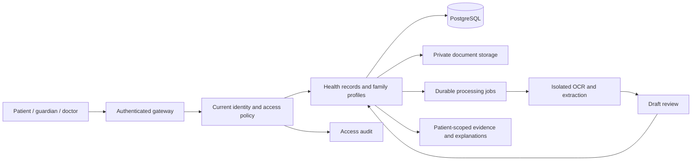

# MediVault: patient, family and doctor ecosystem

Decision date: 24 October 2026. Owner-approved direction: India first; adults,
children, caregivers, a family-tree card, and verified doctors. This supersedes
the old patient-only MVP restrictions. This is a product/engineering blueprint;
planned capabilities below must not be presented as implemented.

## 1. Product purpose

Give a patient and their chosen care team a reliable, understandable history of
care: original prescriptions and reports, dated visits, medicines reportedly
being taken, recorded reactions, and explanations tied to evidence. The primary
outcome is a better-informed consultation and less administrative burden.

The product records diagnoses explicitly documented by clinicians, with source
and verification status. It does not infer a disease from a lab value, infer why
a symptom occurred, prescribe, substitute medicines, or predict disease. Risk
prediction and composite health scores already in the repository remain offline
research, outside this product roadmap.

Example explanation: “This result is above the reference interval printed by the
lab. The report alone does not establish the cause. Here is what this test
measures and the questions you can take to your doctor.” Avoid “this high result
is causing your symptoms” unless reporting an attributed clinician assessment.

## 2. Research and reference products

The medication-history problem is supported by WHO's work on medication safety
at transitions of care. It supports patient-held lists and structured
reconciliation with health professionals; an OCR list alone is insufficient.
[WHO technical report](https://www.who.int/publications/i/item/WHO-UHC-SDS-2019.9)

The user's reference is **myCGHS 2.0**. The MoHFW 2025–26 annual report describes
appointments, medication/referral history, electronic cards and facility
location. This is distinct from the CGHS transaction/claims platform and from
the earlier NIC myCGHS app. The older official NIC description also provides a
useful workflow reference for lab reports and claim status; it is not proof that
every historical function has identical behavior in version 2.0.
[MoHFW annual report, CGHS section p. 88](https://notto.mohfw.gov.in/WriteReadData/Portal/News/951_1_Annual_Report_of_the_MoH_FW__2025_-_2026.pdf),
[official CDAC app listing](https://play.google.com/store/apps/details?id=com.cdac.cghsmobileapp),
[NIC myCGHS overview](https://informatics.nic.in/files/websites/july-2024/mycghs.php)

| Reference pattern | MediVault adaptation | Integration boundary |
|---|---|---|
| Beneficiary and family cards | Patient card and privacy-aware family-tree card | MediVault identity is not proof of CGHS eligibility |
| Medical and medicine history | Cross-provider timeline with original documents and reconciliation | User upload first; provider feeds later |
| Appointments | Visit preparation, appointment diary and follow-up reminders | Real booking needs provider availability and confirmation |
| Referrals | Store referral, purpose, date, destination and stated validity | Do not issue an official referral or invent an expiry |
| Claims | Bills, document checklist, submitted dates and status diary | Official status/payment needs an authorized insurer or scheme feed |
| Facility locator | Verified directory with source and last-updated date | Do not promise empanelment or cashless eligibility from stale data |

India already has broader PHR offerings. The government's June 2026 description
of Aarogya Setu 2.0 includes family profiles, AI record digitization, reminders,
consent management and insurance-related views. Eka also markets patient records
and doctor workflows. These are feature claims by their publishers, not
independent quality/security assessments. MediVault should compete on verified
information, comprehensible explanations, accessibility and consultation
handoff quality; “first complete healthcare ecosystem” is not a defensible claim.
[PIB launch announcement](https://www.pib.gov.in/PressReleasePage.aspx?PRID=2278988&lang=2&reg=48),
[Eka patient product](https://www.eka.care/eka-for-patients)

## 3. People, identities and permissions

Separate **account** (who signs in), **patient profile** (whose care this is),
**relationship** (family connection), and **authority** (what the actor may do).
A child needs a patient profile without needing a login. A doctor can also be a
patient, with an explicit context switch. Do not overload one role column into
both identity and authorization.

| Actor | Permitted behavior | Boundary |
|---|---|---|
| Patient | Manage own records; approve sharing; see access history | Cannot alter another profile by changing an ID |
| Verified doctor | Read granted records; add attributed review/encounter notes if separately authorized | Doctor status alone grants no patient access |
| Parent/lawful guardian | Manage a dependent within verified authority | Family membership is insufficient |
| Adult caregiver | Assist within the adult's explicit, scoped delegation | Relationship, age or disability does not itself confer authority |
| Support/verifier | Account recovery or professional/guardian verification tasks | No routine medical-document access |
| Processing worker | Read one authorized job's inputs and write its outputs | No unrestricted patient search or account management |

Doctor onboarding: pending → verified / rejected → suspended. Verify professional
registration and identity, record verifier and expiry/recheck policy, and never
accept `doctor_verified` from registration JSON. India's HPR is a reference for
verified professionals, not an automatically available integration.
[Government HPR description](https://www.india.gov.in/category/health-wellness/subcategory/health-care-promotion-products/details/information-on-healthcare-professionals-registry-hpr)

Every access decision must include actor, patient, action, resource, purpose,
time, active account, current professional/guardian status, and an applicable
grant. Scope grants by document/category, date interval, permitted actions and
expiry. Read permission must not imply export, editing, or onward sharing.
Re-evaluate on each request and on export/job execution. Revocation blocks future
access, but cannot recall a copy already downloaded; explain that at sharing time.

## 4. Family-tree card and children

The family screen presents accessible cards connected by labelled relationships,
with a list alternative on small screens. A card shows a consented display name,
relationship, age group, and access state: “Your profile”, “Managed dependent”,
“Access granted”, “Invitation pending”, or “Private”. Do not put medication names,
diagnoses, allergy details or record counts on unauthorized family cards.

Actions: invite an adult, accept/decline a connection, add a dependent after
verification, request access, switch profile, manage delegation, and remove a
relationship. Family groups allow multiple guardians/caregivers and blended or
non-biological families. Relationship removal and access revocation must be
explicit and auditable; neither deletes the patient's record.

An adult invitation requires recipient acceptance and minimal pending metadata.
Do not upload another adult's records merely because their card was created.
Do not allow searching the global patient directory by name/phone. The family
graph itself is private and not automatically shared with a consulting doctor.

For children: record verified guardian authority, its source, scope and review
dates; handle disputed or terminated authority through a restricted review
process. Avoid default public child profiles and shared family passwords. Child
access, assent and sensitive-record handling need a pediatric/legal workflow,
not only an age check. Plan notices before age 18 and a verified transfer of
control; expire/reassess guardian grants rather than silently retaining them.
Provide a recovery path that preserves the patient's records.

India's final DPDP Rules describe verifiable parental consent and lawful-guardian
checks, with phased commencement and specified exceptions. Do not assume a
consumer PHR qualifies for a healthcare exemption. These requirements and
sector-specific confidentiality rules need an applicability review before a
child pilot. See the security plan for the cited legal sources.

## 5. Documents, visits and prescriptions

Document flow: upload → quarantine/scan → classify → extract draft → review →
confirm structured facts → publish to timeline. Keep the original immutable;
corrections create revisions. Detect duplicate uploads by patient-scoped hash;
never leak whether another patient has uploaded the same file.

Store separately: upload timestamp, document/issue date, visit date, specimen
date and result date, with unknown/conflicting states. Include hospital/clinic,
author, specialty and visit reason when documented or explicitly entered. Show
which details came from the document and which were added by the patient.

Prescriptions need raw medicine text, ingredient/brand candidate, strength,
formulation, dose, route, frequency, duration, start/end dates, PRN instructions,
prescriber and page/region evidence. Unknown fields stay unknown. Never guess
an unreadable dose or silently substitute a similar drug name.

OCR is text recognition; structured understanding and validation are additional
steps. Keep native PDF/Tesseract as a baseline; benchmark local PaddleOCR and
layout extraction on consented, representative Indian documents. Managed OCR
can be compared only after processor, retention and transfer review. Azure's
Read model documents printed and handwritten extraction, but that is not a
prescription-accuracy guarantee. Select on measured critical-field accuracy,
abstention, review burden, cost and latency, not vendor demos.
[PaddleOCR documentation](https://www.paddleocr.ai/main/en/index.html),
[Azure Read documentation](https://learn.microsoft.com/en-us/azure/ai-services/document-intelligence/prebuilt/read?view=doc-intel-4.0.0)

The review UI places the original page beside highlighted extracted fields.
Human confirmation is mandatory before draft medication data becomes a
current-medication entry or drives a reminder. A language model may assist
extraction/explanation but receives no authority to edit confirmed care records.
Uploaded document text is untrusted content, not instructions to the system.

## 6. Medication, allergy and consultation records

Maintain separate entities for prescribed medicine and reported use. A prescribed
course does not establish that it was started, dispensed, completed or is still
active. Track active/stopped/completed/on-hold/unknown status, who asserted it,
when last reconciled, and the supporting prescription. Ask the patient to review
the list before a consultation; show stale information prominently.

For reactions record suspected substance, raw brand name, reaction description,
date, severity if reported, source, verification status, and clinician review.
Distinguish reported reaction, confirmed allergy, intolerance and refuted/error
entries. “Not recorded”, “unknown” and “no known allergies, assessed by X on Y”
are different states. Never manufacture a negative allergy history from an
empty table. A patient may report a suspected reaction without proving causality.

FHIR R4 separates MedicationRequest (prescription/order) from MedicationStatement
(reported use), and AllergyIntolerance supports uncertainty and verification.
Use those semantics internally before building an interoperability adapter.
[MedicationRequest](https://hl7.org/fhir/R4/medicationrequest.html),
[MedicationStatement](https://www.hl7.org/fhir/R4/medicationstatement.html),
[AllergyIntolerance](https://hl7.org/fhir/R4/allergyintolerance.html)

The doctor handoff shows: selected patient, active access scope, reported
medicines with last-reviewed dates, reported/verified reactions, documented
conditions, recent visits/results, original documents and unresolved corrections.
Show “partial record shared” if scope is limited. Omitted information must not
look like absence of a condition. Doctors append attributed reviews; they do not
overwrite patient reports without traceability.

Future drug/allergy matching is clinician decision support: ingredient mapping,
combination products and a licensed maintained knowledge source are prerequisites.
No “safe to take” declaration, automatic substitution or dosing recommendation.

## 7. Patient problems and feature priorities

These are proposed hypotheses to validate with patients, caregivers and clinicians;
no user interviews have been conducted in this task.

| Patient problem | Proposed feature | Priority / dependency |
|---|---|---|
| Lost papers and forgotten visit details | Document vault, visit timeline, source viewer | Core |
| Forgotten medicine names/current status | Reconciled medication list with packaging/photo attachment | Core |
| Prior reactions not communicated | Clearly visible, attributed reaction/allergy history | Core |
| Difficulty understanding a report | English/Hindi plain-language explanation with source | Core |
| Managing children or an older relative | Family cards, verified guardianship, scoped caregiver delegation | Core |
| Repeating history at every consultation | Patient-approved consultation summary | Core |
| Unclear who can see data | Consent inbox, revoke controls, patient access history | Core |
| Wrong dates or OCR mistakes | Correction workflow and visible revision history | Core |
| Missed follow-ups/refills | Appointment diary and reminders from confirmed instructions | Next |
| Confusing referrals and claims | Referral wallet, bill organizer and claim checklist/status diary | Next |
| Low literacy, disability or weak connectivity | Large text, keyboard/screen-reader support, bilingual UI, explicit offline export | Core UX; offline cache later |
| Unclear tests due before a visit | Checklist copied from clinician instructions; no inferred test ordering | Next |
| Finding appropriate facilities | Sourced directory with accessibility and contact information | Integration |
| Duplicated tests across hospitals | Show previous test/report dates to patient and doctor | Next; do not decide to skip tests |
| Vaccination papers for a child | Immunization record and reminders from verified schedule/provider | Later clinical-content review |
| Recovery after phone loss | Verified recovery, session termination, delegated assistance | Security prerequisite |
| Reimbursement burden | Export selected bills and supporting documents; official status when integrated | Integration |

Do not fabricate real-time appointment availability, medicine stock, insurer
coverage, government eligibility or ambulance dispatch. Link to authorized
services or clearly label manual entries until integrations exist. No sensitive
content in push notifications by default. Reminder failure must not appear as
proof a medicine was taken.

## 8. Architecture and data model

Keep React, the BFF, auth, health and AI services. Add modules within those
boundaries before creating more microservices. PostgreSQL is the system of
record; private encrypted object storage holds originals; an isolated worker
with durable jobs performs OCR. Derived indexes must retain patient and source
scope and support deletion/revocation.

| Entity | Key fields / relationships | Interoperability direction |
|---|---|---|
| PatientProfile | patient ID, birth date/provenance, account link optional | Patient |
| PractitionerProfile | account, registration, verification history | Practitioner / PractitionerRole |
| FamilyRelationship | two profile references, relationship, acceptance/visibility | RelatedPerson where appropriate |
| AuthorityGrant | actor, patient, legal/delegated basis, verification, dates/status | RelatedPerson + policy; relationship alone is insufficient |
| AccessGrant | patient, recipient, actions/resources, purpose, validity, revocation | Consent |
| Encounter | patient, date, facility, clinician, reason, source | Encounter |
| ClinicalDocument | patient, kind, hash, object key, dates, immutable versions | DocumentReference |
| ExtractionDraft | document/version, field values, regions, model/version, review | Provenance |
| PrescriptionItem | patient, source prescription, drug/directions, author | MedicationRequest |
| MedicationUse | patient, reported use/status, reviewer/date, source | MedicationStatement |
| AllergyRecord | substance, reaction, certainty/status, reporter/reviewer | AllergyIntolerance |
| Observation | patient, value/unit/reference/date, source | Observation / DiagnosticReport |
| DocumentedCondition | clinician-attributed text/code and verification | Condition |
| AuditEvent | actor, patient, action, resource, decision, grant, timestamp | AuditEvent |

[FHIR DocumentReference](https://hl7.org/fhir/R4/documentreference.html),
[FHIR Consent](https://hl7.org/fhir/R4/consent.html),
[FHIR RelatedPerson](https://hl7.org/fhir/R4/relatedperson.html)

Migration: create a patient profile for each existing account; add patient_id to
health records, backfill and validate ownership; preserve the original uploader
as provenance. Only then migrate queries to policy-authorized patient scope.
Do not remove existing owner filters before the replacement is tested. Avoid
equating the current account UUID with a child's identity.

ABDM integration is a later adapter and onboarding workstream, not an ABHA
number field or a claim of certification. Confirm the then-current NRCeS profiles
in the sandbox, consent exchange, identity linking and HIP/HIU responsibilities.
ABHA must not be an authentication secret or grant to read a person's records.

## 9. First complete journey and success criteria

A guardian signs in, selects their verified child's profile, uploads a
prescription and report, reviews uncertain fields, confirms reported medication
use, records a suspected reaction, and sees dated events. They grant a verified
doctor a limited consultation view. The doctor sees the sources and uncertainty,
adds an attributed review, and loses access after revocation/expiry. The family
card never exposes those details to a relative without access.

Measure review completion and correction rate, critical extraction errors,
consultation preparation time, completeness/staleness of medication lists,
understanding of sharing scope, and unauthorized-access regression results.
Validate accessibility and patient comprehension with participants. Do not use
synthetic benchmark scores as evidence of clinical benefit or deployment security.

Implementation order, acceptance gates and current delivered changes are in
[ECOSYSTEM_DELIVERY_PLAN.md](ECOSYSTEM_DELIVERY_PLAN.md). Security requirements and
India-specific research are in [SECURITY_AND_PRIVACY_PLAN.md](SECURITY_AND_PRIVACY_PLAN.md).
