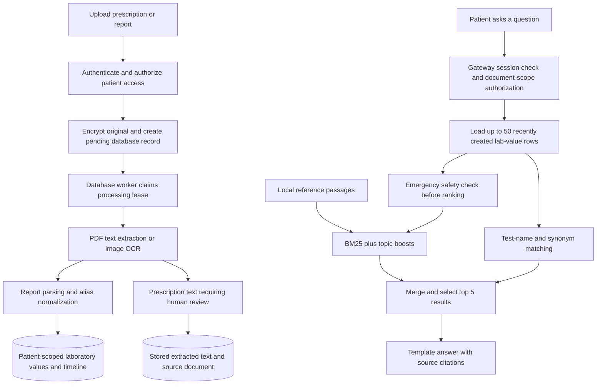

# MediVault information retrieval: technology, algorithms and implementation

**Prototype update:** Prescription OCR now feeds conservative rule-based medicine
drafts (`care/prescription_candidates.py`). Numbered/labelled medication lines with
strength/formulation cues retain source text and line numbers; negative/history
lines are excluded. Dose and current-use status are not inferred from strength.
The user compares the original, edits and explicitly selects/approves rows. The
review endpoint enforces document and medication permissions, locks the source
report and atomically saves source-linked medicines and a review audit snapshot.
Repeat approval is rejected. This is a human-reviewed transcription workflow,
not clinically validated entity extraction. Prescription text still does not enter
the lab-focused Q&A evidence payload. See [demo guide](PROTOTYPE_DEMO_GUIDE.md).

**27 October presentation fixes:** medicine instruction lookup tolerates up to three
intervening blank OCR lines, while stopping at any other content. Simple English
definition questions first look for a complete explicit definition sentence in the
loaded curated corpus, falling back to the existing ranker if none is found. This
prevents the tested haemoglobin question from returning platelet or HbA1c fragments;
broader answer relevance and clinical validation remain separate work.

**Code review date:** 26 October 2026  
**Scope:** Current local application, optional retrieval backends and separate research code.  
**Evidence:** Repository implementation and saved evaluation artifacts; no new performance benchmark was run for this document.

## 1. Executive overview

MediVault currently retrieves information through two main paths:

1. **Structured patient records:** authenticated, patient-scoped SQL queries retrieve documents, laboratory values, medication entries, allergies and care history.
2. **Report Q&A:** BM25 lexical ranking searches a local medical reference collection, while name/synonym matching selects relevant laboratory values from the authorized patient's records. A deterministic template combines the results with citations.

OCR makes uploaded information machine-readable; it is an ingestion step, not the search algorithm. The current Q&A system is retrieval-assisted and template-based. It does **not** call a generative LLM to compose answers.

The repository also implements semantic search, hybrid ranking and longitudinal evidence selection. Their presence in the repository does not mean the running application uses them. In particular, the research longitudinal adapter does not replace the current `/qa` route.

## 2. Technology inventory and actual status

| Layer | Tools / technology | Purpose | Current status |
|---|---|---|---|
| Service APIs | Python, FastAPI, Pydantic, HTTPX | Validate requests and connect gateway, health and AI services | Active |
| Relational retrieval | PostgreSQL, SQLAlchemy async ORM, asyncpg | Retrieve permitted records with filters, sorting and limits | Active |
| Schema management | Alembic | Version database schema and indexes | Active; local schema through migration 013 |
| Image OCR | Tesseract, pytesseract, Pillow | Read English/Hindi text from images and TIFF frames; honor EXIF orientation | Active |
| PDF extraction | pdfplumber, PyMuPDF | Read native text or render pages for OCR | Active; decision made per page |
| Lab parsing | Python regular expressions and date parsing rules | Extract test names, values, units, ranges and dates | Active; supported layouts only |
| Terminology normalization | Alias dictionaries and unit-label rules | Map recognized variants to canonical analyte names | Active |
| Reference search | Custom pure-Python Okapi BM25 | Rank local knowledge-base passages | Active default |
| Query relevance | Deterministic medical-topic boosts and lab-name synonyms | Improve matching for common lab questions | Active |
| Answer composition | Extractive sentence selection, templates, citation formatting | Present retrieved references and patient values | Active; no external LLM |
| Optional semantic search | Sentence Transformers; BGE-small-en-v1.5 / MiniLM; character TF-IDF fallback | Match similar meanings or character patterns | Implemented; not enabled by the local launcher |
| Optional vector indexes | FAISS IndexFlatIP, NumPy | Exact normalized inner-product search | Optional; not approximate HNSW search |
| Research retrieval | BM25, dense embeddings, weighted fusion, RRF, concept/temporal/trajectory scoring | Evaluate richer patient-history questions | Separate research pipeline |
| Original-file protection | cryptography/Fernet | Encrypt stored originals; decrypt authorized downloads | Active for new originals |
| Verification | pytest, PostgreSQL integration tests, local OCR/API scripts | Check behavior and access boundaries | Active test tooling |

The database runs from a pgvector-capable PostgreSQL image. That does **not** establish that live Q&A uses pgvector similarity queries. Its default knowledge-base index is in process memory. Elasticsearch, OpenSearch, Pinecone, Supabase, LangChain and an external LLM are not required by this local retrieval path.

## 3. Data flow



The pediatric branch withholds automated interpretation. Emergency matches return the deterministic safety response instead of ordinary retrieval. The health service loads authorized rows before calling the adult AI endpoint; the AI endpoint runs its safety check before ranking or synthesis.

Prescription OCR text is stored and displayed for review, but it is **not currently included in the Q&A evidence payload**. Neither are medication, allergy or encounter tables. Those records are retrieved through their dedicated care APIs and consultation summary.

## 4. Ingestion: making documents retrievable

### 4.1 Extraction

- Uploads are bounded and inspected for file type before storage.
- New originals are encrypted under opaque filenames.
- A durable worker claims pending documents with a processing token. Results must belong to the current processing lease before they are persisted.
- PDF pages with sufficient native text and no embedded images use native extraction. Other pages are rendered for Tesseract. This avoids skipping a scanned page after a text-only cover.
- Images are processed with `eng+hin`; TIFF frames are handled individually. Documents are limited to 40 pages/frames in this OCR backend, with a 30-second Tesseract timeout per image.
- Lab reports pass through regex parsing and deterministic explanations. Prescription/discharge/other documents currently return extracted text for review.

This is not verified medication entity extraction. Drug identity, strength, dose, schedule and duration are not yet guaranteed structured fields inferred from a prescription. Clear printed synthetic documents have been checked; real handwriting requires a separate labeled evaluation.

### 4.2 Normalization and provenance

The alias normalizer maps examples such as `Hb`, `Hgb` and `hemoglobin` to `Haemoglobin`. Unit-label normalization is not a general physical unit-conversion engine. Do not compare incompatible units merely because names match.

Report values and timeline records can preserve canonical names, dates, reference ranges, source links, date confidence and provenance. The schema also accommodates concept/LOINC identifiers; schema support does not guarantee every uploaded observation receives a validated terminology code.

Source: [parser](../services/ai-service/routers/parse.py), [OCR backend](../services/ai-service/ocr/tesseract_backend.py), [normalizer](../services/ai-service/adapters/normalizer.py).

## 5. Current Q&A retrieval algorithms

### 5.1 Reference passage preparation

At AI-service startup, the bootstrap loads `.txt` references from `data/knowledge-base`. It reads source-title, URL and licence headers, then splits content into passages targeting **300 words with 50-word overlap**, respecting section boundaries where possible. The default runtime builds an in-memory index; it does not re-embed documents on every question.

Source: [ingester](../services/ai-service/rag/ingester.py), [bootstrap](../services/ai-service/rag/bootstrap.py).

### 5.2 BM25 lexical ranking

The custom tokenizer lowercases English alphanumeric tokens, removes a small English stopword set and drops one-character tokens. Each passage is ranked using:

```text
BM25(q,d) = sum over query terms t of:
  IDF(t) × f(t,d)(k1 + 1) / [f(t,d) + k1(1 - b + b|d|/avgdl)]

IDF(t) = ln[1 + (N - df(t) + 0.5)/(df(t) + 0.5)]
k1 = 1.5; b = 0.75
```

`f(t,d)` is term frequency, `df(t)` is the number of passages containing the term, `N` is passage count and `avgdl` is average tokenized passage length. Rare matching terms get more weight; repeated terms saturate; passage length is normalized.

Raw scores are min-max normalized. If all raw scores are equal, normalization returns zeros. There is no learned relevance classifier in this default path.

Source: [BM25 implementation](../services/ai-service/rag/bm25.py).

### 5.3 Medical-topic boosts

Rules detect CBC, lipid, thyroid, HbA1c/glucose and general lifestyle topics. Matching topic keywords add **0.18** for the four clinical topic groups or **0.05** for the general group; the accumulated boost is capped at **0.35**.

```text
Default reference score = normalized BM25 + topic boost
```

These are hand-set relevance heuristics, not probabilities or clinically calibrated confidence. Some checks use substrings, which can produce accidental matches.

Source: [intent rules](../services/ai-service/rag/intent.py).

### 5.4 Patient-result matching and top-k selection

The health service supplies at most **50 lab-value rows**, ordered by row creation time descending. This is not the same as ordering by clinical observation date, and it is not a search of the patient's complete lifetime record.

The retriever matches test names and selected synonyms, such as `Hb`/`hemoglobin` or `LDL`/`bad cholesterol`. Each matched patient result receives a fixed score of **0.85**. Reference passages and patient results are merged, sorted by score, and truncated to **five total results**.

Consequences:

- High-scoring reference passages can displace personal observations; personal evidence does not have a reserved quota.
- The fixed patient score is not comparable to a calibrated probability.
- Questions such as “compare my last three results” are not reliably handled by this simple selection logic.
- Text-only values need careful handling: the current numeric-value lookup may render `None` when the numeric field exists but is null instead of using the text value.

Source: [patient payload loader](../services/health-service/routers/qa.py), [ranking and merging](../services/ai-service/rag/retriever.py).

### 5.5 Answer composition and language support

The synthesizer takes up to three meaningful sentences from each retrieved reference passage, applies limited tone-rewriting rules, adds patient-result bullets and formats citations. If no chunks are available, it returns an insufficient-information response.

This is extractive/template synthesis, not a reasoning LLM. Citations establish where displayed text came from; they do not independently prove medical correctness. Patient citations use report dates rather than a complete clickable evidence-ID chain.

The Q&A Hindi body uses phrase substitution and a Hindi surrounding template; patient bullets can remain English. It is **not a complete medical translation system**. Per-result English/Hindi lab explanations are a separate deterministic component. Both require clinical and comprehension review before production claims.

Source: [synthesizer](../services/ai-service/rag/synthesizer.py).

## 6. Optional semantic and hybrid implementations

There are two optional service-level mechanisms, which should not be conflated:

| Mechanism | Activation / selection | Algorithm |
|---|---|---|
| Legacy KB hybrid | Bootstrap considers `MEDIVAULT_USE_DENSE`, `MEDIVAULT_FAST_KB` and the newer embedding flag | MiniLM cosine scores; `0.7 × normalized BM25 + 0.3 × normalized dense + topic boost` |
| Semantic adapter | `USE_EMBEDDING_SEARCH=1` selects `SemanticRetrieverAdapter` through the registry | Configured embedding backend and FAISS/NumPy search; fallback to BM25 on exception or empty results |

The semantic model configuration names **BAAI/bge-small-en-v1.5**, **sentence-transformers/all-MiniLM-L6-v2**, and an offline **character TF-IDF** fallback. Automatic model downloading is disabled in the checked-in configuration. A fallback result must not be described as transformer inference without recording which backend actually ran.

FAISS uses **IndexFlatIP on normalized vectors**, equivalent to cosine ranking. It is exact flat search, not an approximate nearest-neighbor graph. The NumPy backend provides a similar exact-search fallback. These options reduce dependency fragility but do not establish large-corpus scalability.

The local launcher explicitly disables `USE_EMBEDDING_SEARCH` and other optional ML flags. Legacy dense environment flags are separate controls; inspect them as well when reproducing a deployment. Registry choices are cached in process, so restart after configuration changes.

Sources: [registry](../services/ai-service/core/registry.py), [adapters](../services/ai-service/adapters/retriever.py), [model configuration](../models/retrieval/config.yaml), [vector stores](../models/retrieval/vector_store.py), [local launcher](../scripts/dev.py).

## 7. Longitudinal research pipeline — implemented separately

The research pipeline operates on atomic patient observations (`ResearchEvidenceRecord`) and structured `ClinicalQuery` objects rather than only reference passages.

| Component | Implemented approach | Intended benefit |
|---|---|---|
| Query understanding | Rule-based analyte, intent and temporal-operator parsing | Distinguish latest, prior, last-N, interval and comparison questions |
| Lexical evidence retrieval | BM25 over observation representations | Match precise analytes and terminology |
| Dense evidence retrieval | Locally cached MiniLM; deterministic TF-IDF + SVD fallback | Add semantic/lexical-vector similarity |
| Weighted fusion | `alpha × lexical + beta × dense` | Combine signals; simple hybrid defaults to 0.5/0.5 |
| Reciprocal rank fusion | `1/(60 + lexical rank) + 1/(60 + dense rank)` | Combine rank positions without requiring identical score scales |
| Concept scoring | Canonical analyte/concept/LOINC alignment | Reduce confusion between clinically different observations |
| Temporal scoring | Latest, previous, last-N and date-window alignment within analyte series | Match the requested point or interval in history |
| Trajectory and evidence selection | Series-aware reranking and primary/supporting evidence selection | Preserve useful comparison and trend evidence |
| Grounded synthesis evaluation | Fact extraction, grounding verification and deterministic synthesis experiments | Check whether claims remain supported by selected evidence |

The modular weighted form is:

```text
S = alpha*lexical + beta*dense + gamma*concept + delta*temporal + epsilon*intent
```

The research helper named `normalize_min_max` currently uses **max scaling** (`score/max_score`), not ordinary min-max subtraction. This differs from the live KB retriever. Research hybrid implementations filter by patient before candidate ranking, but that filter alone is not the application's full consent/guardian authorization system.

The separate adapter explicitly states that it does not replace existing Q&A. Integrating it requires consent-aware loading, evidence provenance, unit handling, endpoint tests and clinical evaluation. Research abnormality heuristics must not silently become production diagnostic rules.

Sources: [research pipeline](../packages/research-data/retrieval/pipeline.py), [hybrid](../packages/research-data/retrieval/hybrid.py), [dense](../packages/research-data/retrieval/dense.py), [temporal](../packages/research-data/retrieval/temporal.py), [service adapter](../services/ai-service/adapters/evidence_retriever.py).

## 8. Retrieval privacy and database boundaries

1. The gateway validates the session and obtains the current account identity. Browser-supplied identity headers are not trusted.
2. Internal service authentication prevents unauthenticated direct access to protected health/AI routes.
3. The health service resolves patient ownership or an active scoped grant, including guardian/clinician restrictions.
4. SQL filters restrict report IDs before values are loaded; retrieval never receives a global unfiltered patient corpus from the browser.
5. The server constructs the patient-value payload. The public Q&A schema does not accept arbitrary `user_report_values` supplied by a client.
6. Document, timeline and care-category endpoints apply their own authorization boundaries; family membership is not automatic access.
7. Revocation is checked on future requests. It cannot retract information a previously authorized recipient has already downloaded.

Original files are encrypted. Parsed text and structured fields are currently readable to the database/server operator; production database and backup encryption, key management and operator restrictions remain launch gates. Do not claim end-to-end encryption or rely on similarity ranking as an access-control mechanism.

Source: [document scope](../services/health-service/care/document_scope.py), [care policy](../services/health-service/care/policy.py), [report repository](../services/health-service/db/repositories/report_repository.py), [core verification](CORE_VERIFICATION.md).

## 9. Efficiency: benefits and limits

**Implemented benefits:** startup-built reference index; process-cached component selection; no network LLM inference in default Q&A; bounded personal-value payload; top-five output; asynchronous service/database access; durable OCR processing outside the upload response; direct structured SQL retrieval for care records rather than semantic searching every field.

**Important limits:** the current BM25 scorer scans passage token lists and rebuilds term-frequency counters on each query, then sorts candidates. It is a small-corpus implementation, not a postings-list search engine. Exact vector search also scans candidates. The 50-row payload cap controls work by omitting older rows; it is not a relevance-preserving optimization. Full patient-history queries need a better candidate-selection strategy.

No current end-to-end p50/p95 latency, throughput or memory benchmark is established by the functional test count. SQL query plans and index adequacy should be measured with realistic authorized data volumes before scale claims.

## 10. Evaluation evidence and how to interpret it

The latest documented local core verification records **255 passing selected regression tests**, live OCR/storage/security checks and successful build compilation. These establish tested behavior, not general retrieval accuracy or clinical safety. See [core verification](CORE_VERIFICATION.md).

An existing research artifact dated 9 October 2026 reports a controlled Synthea sample of **60 patients and 2,790 observations**. Selected rows from its end-to-end test report are:

| Research method | MRR | Recall@5 | nDCG@5 |
|---|---:|---:|---:|
| BM25 | 0.7105 | 0.7867 | 0.7139 |
| Dense | 0.6520 | 0.8733 | 0.6876 |
| RRF | 0.7613 | 0.9467 | 0.7967 |
| Hybrid + Temporal + Concept | 0.6613 | 0.8067 | 0.6881 |

These are saved research results, not freshly reproduced measurements or live-app scores. They do not show that adding more components always improves retrieval. The later audit reclassified the original inspected test questions as **TEST-DIAGNOSTIC** and established a separate held-out query set; respect that distinction when presenting results.

- **Recall@k:** proportion of relevant evidence recovered within the first k results.
- **Precision@k:** proportion of returned top-k evidence that is relevant, using the evaluator's denominator convention.
- **MRR:** mean reciprocal position of the first relevant result.
- **nDCG@k:** ranking quality with greater credit for relevant evidence appearing earlier.

Sources: [saved end-to-end comparison](../validation/retrieval/summaries/retrieval_benchmark_test_end_to_end.md), [evaluation integrity audit](../validation/retrieval/summaries/cp08_evaluation_audit_diagnostic_report.md).

## 11. Recommended next engineering stages

These are proposed work, not current capabilities:

1. Replace the recent-50-row Q&A shortcut with authorized analyte/date-aware candidate selection and stable observation-ID citations.
2. Integrate longitudinal query parsing and selection only after checking units, missing dates, consent and patient-specific boundaries.
3. Add reviewed prescription entity extraction with field-level provenance, confidence/abstention and explicit human correction.
4. Improve multilingual query tokenization and replace phrase-substitution Hindi with a clinically reviewed explanation/translation approach.
5. Evaluate on de-identified printed and handwritten prescriptions, real report layouts and adversarial questions; record critical numeric/drug errors separately from average OCR accuracy.
6. Measure p50/p95 latency, Recall@k, evidence coverage, unsupported claims and authorization failures before selecting BM25, dense or hybrid as the deployment default.
7. Optimize SQL indexes and candidate retrieval from measured plans; consider an inverted index or approximate vector index only when corpus size and evaluated benefit justify it.

## 12. Reproduction and related documentation

Start the local stack according to [LOCAL_APPLICATION.md](LOCAL_APPLICATION.md). The backend-only verification scripts are:

```powershell
.\.venv\Scripts\python.exe scripts/check_ocr.py
.\.venv\Scripts\python.exe scripts/smoke_local.py
.\.venv\Scripts\python.exe scripts/smoke_auth.py
```

Research runners are `scripts/run_retrieval_benchmark.py`, `scripts/run_longitudinal_selection_benchmark.py` and `scripts/run_grounded_synthesis_benchmark.py`; consult each runner's `--help` and dataset governance before execution. Do not submit patient data to a research cache or external model endpoint without a separately approved data workflow.

This document describes the current code paths. Older architecture/model documents describe experiments and future options; where activation status differs, use the registry, local launcher and actual route wiring as the source of truth.
